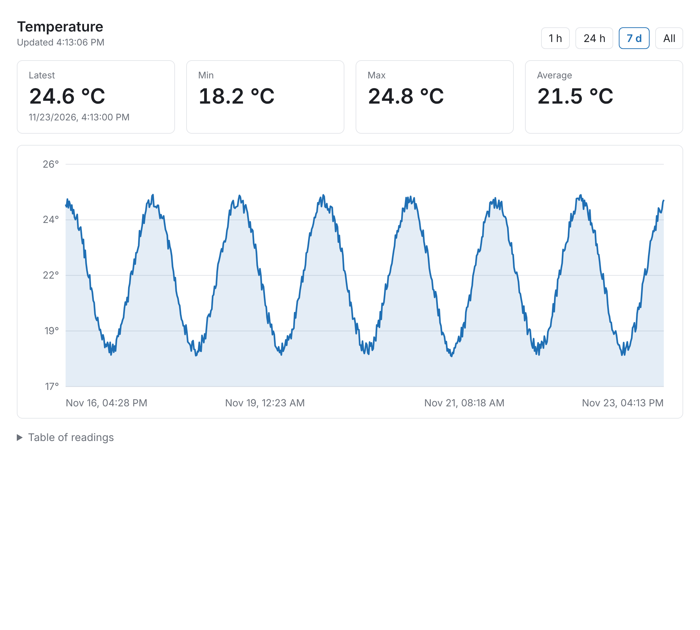

# Raspberry Pi temperature monitor

A small project: a Raspberry Pi reads a DS18B20 temperature sensor and sends each reading over the internet to a receiver you run on a server. Readings are stored in SQLite and can be read back as JSON.

```
[Pi + DS18B20] --HTTPS POST--> [receiver.py on server] --> readings.db
                                        |
                                 GET /readings (JSON)
```

Both scripts use only the Python standard library, so there is nothing to install.

## Hardware

- Raspberry Pi (any model with GPIO)
- DS18B20 temperature sensor (waterproof probe version works well)
- 4.7 kΩ resistor between the data line and 3.3 V
- Jumper wires

| DS18B20 pin | Pi pin |
|---|---|
| VDD (red) | 3.3 V (pin 1) |
| GND (black) | GND (pin 6) |
| DATA (yellow) | GPIO 4 (pin 7) |

## Pi setup

1. Enable the 1-Wire interface: `sudo raspi-config`, then Interface Options, then 1-Wire, and reboot.
2. Check that the sensor appears: `ls /sys/bus/w1/devices/` should show a `28-...` folder.
3. Copy this folder to the Pi, for example to `/home/pi/pi-temperature-monitor`.
4. Test one reading against your server:

   ```bash
   TEMP_API_KEY=your-key python3 sender.py --url https://temps.example.com/readings --once
   ```

5. To run it all the time, edit `temp-sender.service` (URL, key, paths), then:

   ```bash
   sudo cp temp-sender.service /etc/systemd/system/
   sudo systemctl daemon-reload
   sudo systemctl enable --now temp-sender
   journalctl -u temp-sender -f
   ```

## Server setup

Run the receiver on any machine that the Pi can reach over the internet:

```bash
RECEIVER_API_KEY=your-key python3 receiver.py --port 8000 --db readings.db
```

Put it behind HTTPS before exposing it to the internet. For example, with Caddy, a reverse proxy that handles certificates automatically:

```
temps.example.com {
    reverse_proxy localhost:8000
}
```

Use the same key on the Pi and the server. Keys can be generated with `python3 -c "import secrets; print(secrets.token_urlsafe(32))"`.

## Dashboard



*Screenshot with simulated sample data (7 days, one reading every 15 minutes).*

Open `https://temps.example.com/` in a browser. The page shows the latest reading, min, max and average for the selected range (1 h, 24 h, 7 d or all), a line chart with a hover tooltip, and a table of recent readings. It refreshes every 30 seconds.

The dashboard reads `GET /readings` without a key, so anyone with the URL can see the temperatures. Put an access control in front of the server (for example Caddy `basicauth`) if that matters to you.

## Checking the data

```bash
curl "https://temps.example.com/readings?limit=5"
```

## Testing without hardware

`sender.py --simulate` sends random readings around 20 °C, so you can test the full path on a laptop.

## Notes

- If the internet drops, the sender keeps up to 1000 readings in memory and sends them when the connection returns. Readings are lost if the sender process restarts during an outage.
- The API key is sent in a header, so the receiver must sit behind HTTPS.
- Readings outside the DS18B20 range (-55 °C to 125 °C) are rejected.
